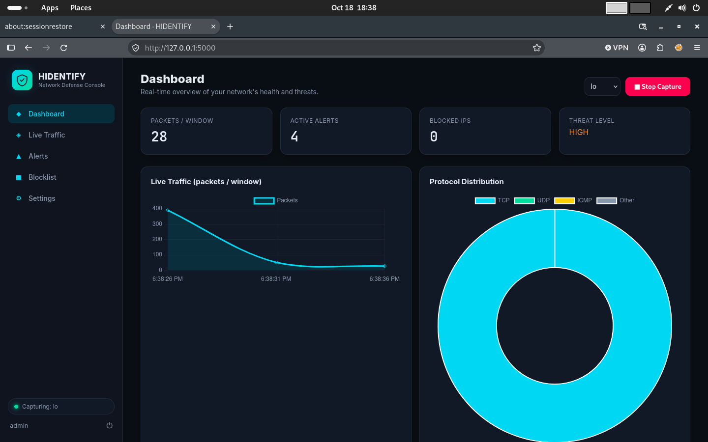
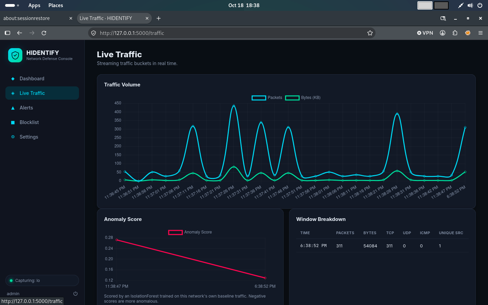
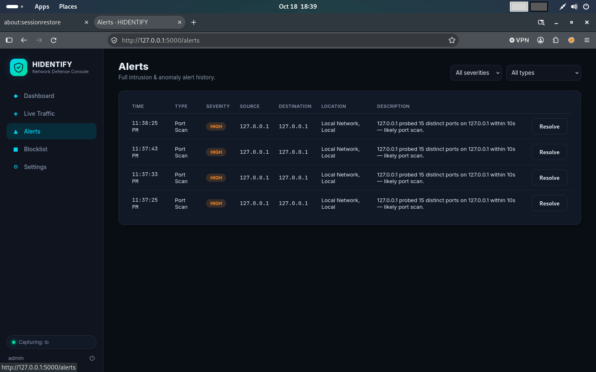
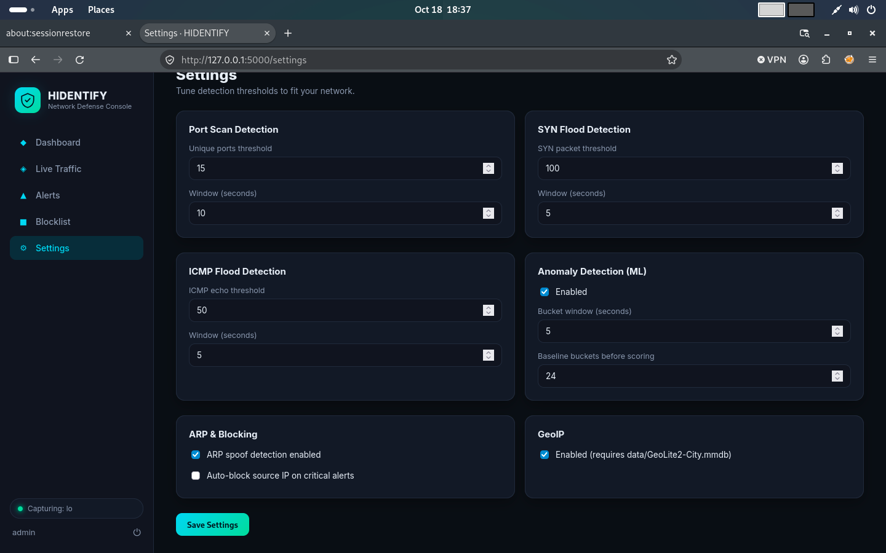

# HIDENTIFY

**HIDENTIFY** is a full-stack Network Intrusion Detection & Monitoring System with a live, browser-based dashboard. It captures live network traffic, detects common attack patterns in real time (port scans, SYN/ICMP floods, ARP spoofing, blocklisted IP activity), scores overall traffic for anomalies with a lightweight machine-learning model, and lets you manage a firewall-backed IP blocklist — all from one clean, modern web UI.

> ⚠️ **Authorized use only.** Run this only on networks and interfaces you own or are explicitly authorized to monitor. Packet capture and network monitoring without authorization may be illegal in your jurisdiction.

---

## Screenshots

**Live dashboard** with real-time traffic, protocol breakdown and threat level


**Live traffic** with per-window stats and the ML anomaly score


**Alert history** with severity and type filters


**Settings** with every detection threshold tunable from the UI


---

## Features

- **Live packet capture** via Scapy — pick any network interface from the UI
- **Real-time detection engine**
  - Port scan detection (many distinct ports from one source, fast)
  - SYN flood / DoS detection
  - ICMP flood (ping flood) detection
  - ARP spoofing / MITM detection (IP↔MAC mismatch)
  - Blocklist-match detection
- **ML-based anomaly detection** — an `IsolationForest` learns a baseline of "normal" traffic on your network and flags unusual bursts, without needing labeled attack data
- **IP Blocklist** with best-effort automatic firewall enforcement (`iptables` on Linux, `netsh advfirewall` on Windows)
- **GeoIP enrichment** for alert sources (optional, bring your own free MaxMind GeoLite2 database)
- **Live dashboard** — KPI cards, real-time traffic & protocol charts, threat level indicator
- **Alert history** with severity/type filtering and manual resolution
- **Tunable settings** — every threshold and time window is adjustable from the UI, no code edits needed
- **Authentication** — simple session-based login gate in front of the whole app
- **Attractive, modern dark-theme UI** built with Chart.js + Socket.IO, no page reloads — everything streams live

## Architecture

```
hidentify/
├── app.py                 # Flask + Socket.IO app, routes, wiring
├── config.py               # Settings & defaults
├── core/
│   ├── sniffer.py           # Scapy-based packet capture engine
│   ├── detectors.py         # Signature/threshold-based detection rules
│   ├── anomaly.py            # Traffic bucketing + IsolationForest scoring
│   ├── alerts.py               # Alert creation, dedup, broadcasting
│   ├── blocklist.py             # Blocklist + OS firewall enforcement
│   └── database.py               # SQLite persistence layer
├── templates/               # Jinja2 HTML (dashboard, traffic, alerts, blocklist, settings, login)
├── static/css/style.css      # Dark theme
├── static/js/dashboard.js     # Socket.IO client + Chart.js wiring
└── data/                        # SQLite DB, settings.json, optional GeoLite2 DB (created at runtime)
```

**How data flows:** Scapy sniffs packets → each packet is parsed into a small dict → sent to every `Detector` and to the `TrafficAggregator` in parallel → detectors raise `Alert`s on rule matches → the aggregator buckets traffic every few seconds and scores it with the anomaly model → both alerts and traffic buckets are pushed live to the browser over Socket.IO and saved to SQLite for history.

## Requirements

- Python 3.9+
- **Root/Administrator privileges** (raw packet capture requires it)
- **Npcap** (Windows) — install from https://npcap.com/ with "WinPcap API-compatible mode" checked
- **libpcap** (Linux/macOS) — usually already present; on Debian/Kali: `sudo apt install libpcap-dev`

## Installation & Running

### Linux / Kali / macOS
```bash
git clone https://github.com/Victor-Ugwuanyi/hidentify.git hidentify
cd hidentify
chmod +x run.sh
./run.sh
```
This creates a virtualenv, installs dependencies, and launches HIDENTIFY with `sudo` (needed for packet capture).

### Windows
1. Install [Npcap](https://npcap.com/) first.
2. Open **Command Prompt as Administrator**.
```bat
git clone https://github.com/Victor-Ugwuanyi/hidentify.git hidentify
cd hidentify
run.bat
```

Then open **http://localhost:5000** in your browser.

**Default login:** `admin` / `hidentify123` — change `DEFAULT_ADMIN_PASSWORD_HASH` in `config.py` before using this on a real company network.

## Running it as a desktop app (no manual browser step)

`desktop.py` is the **one script** for this — it runs the same Flask backend as `app.py`, but tries to open HIDENTIFY in its own native window (via `pywebview`). If that's not available (e.g. inside the standalone executable below, where bundling GTK reliably isn't possible), it automatically opens your default browser instead. Either way, same command, no separate files to choose between.

```bash
# Linux/macOS
sudo venv/bin/python3 desktop.py

# Windows (Admin Command Prompt)
python desktop.py
```

**Linux note:** for the native window, `pywebview` needs a GTK or Qt webview backend installed at the OS level. On Kali/Debian-based systems:
```bash
sudo apt install python3-gi python3-gi-cairo gir1.2-gtk-3.0 gir1.2-webkit2-4.1
```
Without these, `desktop.py` just falls back to your browser automatically — nothing breaks either way.

### Build a real standalone executable
```bash
# Linux/macOS
chmod +x build_linux.sh
./build_linux.sh
# -> dist/HIDENTIFY/HIDENTIFY

# Windows (regular, non-admin Command Prompt)
build_windows.bat
:: -> dist\HIDENTIFY\HIDENTIFY.exe
```
Then run the built executable **with admin/root privileges** (packet capture needs it regardless of how the app is packaged):
```bash
sudo ./dist/HIDENTIFY/HIDENTIFY          # Linux/macOS
```
```bat
:: Windows: right-click HIDENTIFY.exe -> "Run as administrator"
```
The built executable typically opens your default browser rather than an embedded window (GTK's dynamic typelib loading doesn't survive PyInstaller's static bundling reliably on Linux) — this is expected and still a genuine double-click, single-process app.

`build.spec` bundles `templates/`, `static/`, and every Python dependency into one folder — the person running it doesn't need Python installed at all. Its database and settings are stored in a per-user app-data folder (`%APPDATA%\HIDENTIFY` on Windows, `~/.hidentify` on Linux, `~/Library/Application Support/HIDENTIFY` on macOS) instead of next to the executable, since PyInstaller's bundle folder isn't a safe place to write persistent data.

**Heads up:** `scapy` and `scikit-learn` are known to be finicky with PyInstaller's static import scanner (they load some submodules dynamically). If the built exe crashes on launch with a `ModuleNotFoundError`, add the missing module path to `hiddenimports` in `build.spec` and rebuild — `build.spec` already includes the most common ones needed for these two libraries.

## Using GeoIP (optional)

HIDENTIFY works fully without it. To enable country/city lookups on alert sources:
1. Create a free account at https://www.maxmind.com/en/geolite2/signup
2. Download `GeoLite2-City.mmdb`
3. Place it at `data/GeoLite2-City.mmdb`
4. Toggle GeoIP on in Settings

## Detection tuning

Every threshold (port scan sensitivity, flood thresholds, anomaly baseline size, etc.) is adjustable live from the **Settings** page — useful for tuning false-positive rates to your own network's normal traffic patterns.

## Known limitations (good talking points for interviews!)

- ARP spoof detection only sees traffic on the monitored interface/segment (it's not a distributed system).
- Firewall auto-enforcement is best-effort: Linux (`iptables`) and Windows (`netsh`) are supported; macOS blocking is tracked in the UI but not auto-enforced (`pf` requires a pre-loaded anchor).
- The anomaly model establishes its baseline from live traffic after capture starts — expect ~2 minutes before anomaly scoring kicks in.
- This is a defensive monitoring tool, not a full IPS — it can auto-block via the OS firewall but does not perform deep packet payload inspection (no signature/IDS ruleset like Snort/Suricata).

## Roadmap ideas

- Suricata/Snort rule import for signature-based deep packet inspection
- Email/Slack/webhook alert notifications
- Multi-user roles (viewer vs admin)
- pcap export per alert for forensic analysis
- Docker packaging

## Pushing this to GitHub

```bash
cd hidentify
git init
git add .
git commit -m "Initial commit: HIDENTIFY network IDS"
git branch -M main
git remote add origin https://github.com/<your-username>/hidentify.git
git push -u origin main
```

(`.gitignore` already excludes the venv, SQLite DB, and any GeoIP database so your repo stays clean.)

## Disclaimer

HIDENTIFY is an educational / portfolio project demonstrating network security monitoring concepts. Always get written authorization before monitoring any network you don't personally own.
